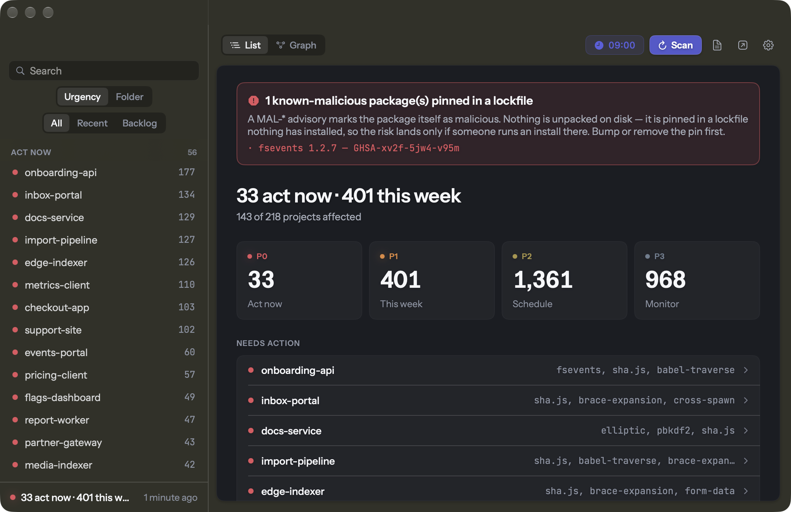
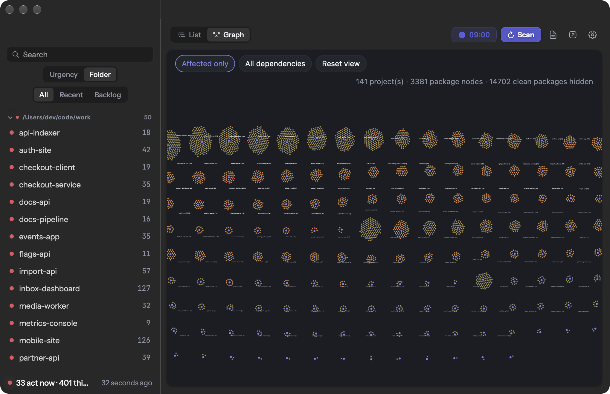

# Vulnerability Radar

A macOS menu bar app and CLI that answers one question: **of the vulnerabilities disclosed this
week, which ones actually touch code on my machine, and what do I do about them?**

Most scanners answer "does this repo have CVEs" one repo at a time. This starts from the other
end — the advisory feed — builds a dependency graph of every project you have, and tells you
which of your projects a newly published advisory lands in. A full sweep of ~220 projects and
~15,000 packages takes about 20 seconds.



## What makes it different

- **Version-range matching, not name matching.** A package is only reported when the resolved
  version you actually have falls inside a published vulnerable range. "You have lodash and
  lodash once had a CVE" is not a finding.
- **Ranked by whether you must act, not by CVSS.** A critical in a dev dependency of a repo you
  abandoned is P2. A high in a runtime dependency you committed to last week is P1. Anything in
  CISA KEV — being exploited right now — is P0.
- **Honest about what it doesn't know.** Findings (version-matched, provable) are kept separate
  from leads (KEV host name-matches, which carry no version ranges and need a human to confirm).
- **Everything stays local.** The only outbound requests are to the GitHub Advisory API and the
  CISA KEV catalog. Your dependency graph is never uploaded anywhere.

## Install

### Homebrew (recommended)

```bash
brew install --cask sauravchamoli17/tap/vulnradar
```

### Download

Grab `VulnRadar.dmg` from [Releases](../../releases), open it and drag the app to
`Applications`. A plain `.zip` of the bundle is attached to the same release if you prefer it.

The app is **ad-hoc signed, not notarised** (notarisation needs a paid Apple Developer account).
macOS will refuse the first launch. To get past it, either right-click the app → **Open** →
**Open**, or:

```bash
xattr -dr com.apple.quarantine /Applications/VulnRadar.app
```

### Build from source

```bash
git clone https://github.com/sauravchamoli17/vulnradar
cd vulnradar/app && bash build.sh
```

Needs Xcode or the Command Line Tools. Nothing else — no Xcode project, no package manager, no
dependencies. The build script compiles with `swiftc`, generates the icon, assembles the bundle
and ad-hoc signs it.

## Use it

The app lives in the menu bar and badges itself with the number of findings that need action
now. Open the window for the project list, the per-project fix commands, and the graph.

It is also a plain CLI:

```bash
bash scripts/radar.sh --days 14                    # everything in your home folder
bash scripts/radar.sh --roots ~/code --days 7      # one tree, tighter window
bash scripts/radar.sh --days 3 --severity "high critical"
bash scripts/radar.sh --no-deep                    # skip osv-scanner, advisory window only
bash scripts/radar.sh --selftest                   # version-matching tests
```

Exit codes: `2` = at least one P0, `0` = nothing needs action, `1` = the run failed. That makes
it usable as a CI gate.

Output lands in `~/.claude/vuln-radar/latest/`:

| File | What it is |
|------|------------|
| `report.md` | ranked action list, per-project, with copy-paste fix commands |
| `graph.html` | self-contained project-wise dependency graph; click any node for the advisories |
| `findings.json` | structured results, for piping somewhere else |
| `graph.json` | the full dependency graph |

### As a Claude Code skill

Drop this directory into `~/.claude/skills/` and Claude Code picks it up as `/vuln-radar`.
`SKILL.md` tells the agent how to run a scan and, importantly, how to report the results without
crying wolf.

Every project on the machine is a cluster; size and colour follow the worst finding in it.



## How it works

| Stage | Question | Source |
|-------|----------|--------|
| **inventory** | What is installed here, and what depends on what? | 15 lockfile/manifest formats + the host layer (macOS, Homebrew, runtimes, Docker images, GitHub Actions) |
| **intel** | What was disclosed recently, and everything else that is known? | GitHub Global Advisory DB for the window + osv-scanner for the full history + CISA KEV |
| **match** | Does an installed version fall inside a vulnerable range? | one comparator across npm/PyPI/Maven/Go/RubyGems/crates/composer semantics |
| **report** | What needs doing, and in what order? | P0–P3 bands, per-project fix blocks, an interactive graph |

Each stage is a standalone script, so you can re-run any one of them on its own.

### Scheduling

Scans can run on a clock — "every weekday at 09:00", not "every 24 hours from whenever you last
launched it". Enable it from the status bar. Turning on *"run when the app is closed"* installs
a `launchd` agent so the report is ready whether or not the app is open.

### Fix with AI

Every project has a **Fix with AI** tab that generates a prompt carrying the advisory evidence —
package, versions, ranges, CVSS, KEV status, summaries, links — and asks a coding agent to
*decide whether the fix is warranted* before changing anything. It deliberately does not assume
the scanner is right, because the scanner knows nothing about how your code uses the package.

## Isn't this just Dependabot?

Partly, and the report says so rather than pretending otherwise. The advisories come from the
same database, so for a GitHub repo with Dependabot alerts on there is genuine overlap — each
project is marked ✓ covered, ◐ partially, or 🔭 not watched at all. Nothing is hidden on the
grounds that Dependabot might also report it.

What Dependabot cannot reach whatever your settings: projects that are not on GitHub, the host
layer (macOS, Homebrew, container images), what is installed in your working tree rather than
on the default branch, blast radius across repos — Dependabot files one PR per repo and cannot
say "one upgrade clears nine projects" — and `MAL-*` malicious-package advisories.

They complement each other: Dependabot opens per-repo PRs continuously; this gives the
machine-wide picture and covers the repos it cannot see.

## Limits

- Advisory coverage is the GitHub Advisory DB. Vulnerabilities with no advisory for the
  ecosystem (OS packages beyond KEV name-matching, vendored code, binaries) are out of scope.
- `--days N` only drives the recency headline; osv-scanner covers full history by default.
- Reachability is inferred from dependency type and commit recency, not from call graphs.
- `bun.lockb` is binary and unreadable; the report names any it skipped.

## Contributing

Adding a lockfile format is one parser in `scripts/inventory.py` plus an entry in `PARSERS`.
Version-matching changes must come with cases in `scripts/vercmp.py` — run
`bash scripts/radar.sh --selftest`.

## License

MIT. See [LICENSE](LICENSE).
